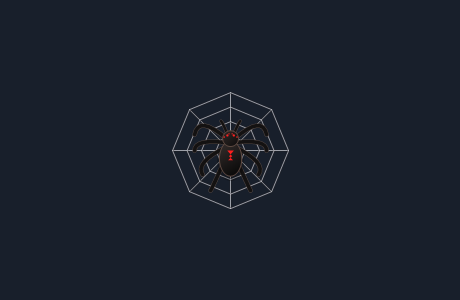

# Halloweb

*A little Halloween spirit for your desktop.*



Halloweb is a tiny Windows desktop spider with somewhere to be. Move your pointer close and it scurries away. Leave your computer quiet and it wanders, chooses a corner, and grows a silvery web.

The spider and its silk float over ordinary desktop windows. Their transparent overlays let your clicks reach the apps underneath.

**Ghost Pointer** adds passive curiosity while wandering. In a window you explicitly approve, the spider can notice a button or menu item, pause, draw its own faint amber highlight, and continue. It does not move your pointer or send hover, click, or activation events to the app. Unapproved windows receive no accessibility queries.

**Idle hanging** is an optional extra. After ten minutes of inactivity, a spider safely at an upper-corner web can lower itself on one silk strand and hang with a gentle sway. A mild disturbance sends it climbing home. A stronger threat can trigger a fast, checked retraction and a small web bounce; an unsafe tether is released so ordinary escape can take over.

## Meet your spider

- After **2 minutes idle**, it starts wandering.
- After **5 minutes idle**, it looks for a quiet corner and builds a web.
- Disturb it and it flees, keeping its unfinished web.
- If the pointer blocks its route home, it waits safely. Clear the route and it can return; weaving resumes when the idle and safety conditions permit.

The Windows app currently uses safe waiting for blocked returns. Automatic detours belong to the separate JavaScript behavior experiments.

## Run

Halloweb targets **Windows 10 or 11, x64** and uses the .NET Framework included with Windows. The desktop app needs no installer or Node.js runtime.

Download the Windows ZIP from [Releases](https://github.com/MythTechOracle/Live-Spider/releases), extract it, and double-click **Halloweb.exe**.

Ghost Pointer and idle hanging are part of the **0.4.0 source build**. The published v0.1.0 ZIP does not include them yet.

Right-click the spider icon in the system tray; it may be inside the tray's up-arrow menu.

| Control | What it does |
| --- | --- |
| **Build a web now** | Opens a 90-second construction window while keeping pointer safety checks active. |
| **Pause / Resume** | Stops or resumes the spider and its construction. Double-clicking the tray icon also toggles pause. |
| **Bring spider near pointer** | Recalls it to your current display and clears its previous web. |
| **Show only on desktop** | Hides the overlays while another app has focus. |
| **Ghost Pointer curiosity** | Toggles passive observation and its synthetic highlight. Enabled at launch, with no windows approved. |
| **Ctrl+Alt+G** | Explicitly approves the currently active window for this session, replacing the previous approval. Available when the shortcut registers successfully. |
| **Revoke Ghost Pointer window approval** | Immediately clears observation, pending results, and the highlight. |
| **Idle hanging from web** | Optional, off at launch. Enables descent after ten minutes idle at an eligible existing web. |
| **Hanging depth** | Chooses Short, Medium, or Long. A full safe downward corridor is required. |
| **Preview hanging in test window** | Opens a separate owned preview with a test web, so you can try the behavior immediately. |
| **Spider size** | Chooses Small, Original, or Large. |
| **Clear web and route memory** | Gives the spider a fresh start. |
| **Exit spider** | Closes the app. **Ctrl+Alt+Q** also quits when that shortcut is available. |

Run the executable again whenever you want the spider back. It stays on its starting display unless recalled. Exclusive full-screen apps and the Windows secure desktop may cover the overlays.

For Ghost Pointer, select an ordinary non-sensitive application window and press **Ctrl+Alt+G** yourself. Approval is never saved across restarts. Leave the computer quiet until the spider wanders across an eligible control. Threats, returning to a web, and construction take priority over curiosity. Unsupported or uncertain targets receive no highlight.

Hanging uses the current web and preserves its construction progress. It needs an upper-corner anchor and sufficient space below it; lower or obstructed webs stay as they are. Pause, display changes, session lock, recall, and shutdown release the suspension safely. The preview supplies its own idle condition and test web; it does not replace your desktop spider's web. See [LIVE-SPIDER-14](docs/LIVE-SPIDER-14.md) for return rules and verification scope.

## Build from source

In PowerShell, from the repository root:

```powershell
./scripts/build.ps1
```

The build produces **dist/Halloweb.exe** using the Windows .NET Framework compiler.

To run the checks:

```powershell
./scripts/verify.ps1
```

Verification also needs Node.js for the independent JavaScript behavior tests. Native Windows source lives in `src/native/`; the JavaScript reference engine is in `src/behavior/`, with its tests in `tests/behavior/`.

## Local by design

Halloweb reads the pointer position locally so the spider can react. It uses Windows' idle-time information without recording keystrokes. Its activity map, web progress, route memory, and recent behavior history stay in memory for the current session. An explicit diagnostic command can export a local history snapshot.

Ghost Pointer reads only an approved point's control role, bounds, enabled/offscreen flags, password flag for denial, and process identity. It performs no UI tree search, document or directory reading, file metadata inspection, clipboard inspection, screenshots, text extraction, or network communication. Known shell/security windows and password-marked hits are declined. Geometry cannot identify every sensitive context, so approve only windows you intend to expose to this limited observer.

Its separate curiosity history keeps at most 64 non-sensitive receipts in RAM. `NO_INPUT_DISPATCHED` describes this engine's lack of input capability; it is not a universal guarantee about external application behavior. See [LIVE-SPIDER-12](docs/LIVE-SPIDER-12.md) for the observation boundary and verification scope.

See [Behavior and verification](docs/BEHAVIOR.md) for the movement rules, diagnostic commands, test evidence, and the differences between the Windows app and the JavaScript experiments.

## Credits and license

Halloweb grew from human creative direction and iterative collaboration: Codex implemented the desktop app and verification work; Gemini contributed behavior prototypes and regression material.

Released under the [MIT License](LICENSE). Copyright © 2026 Nelson Williams.
